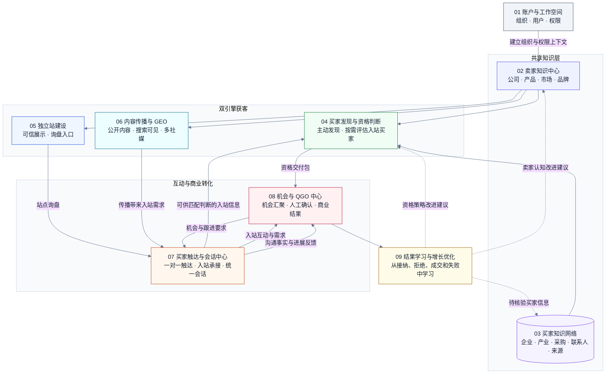
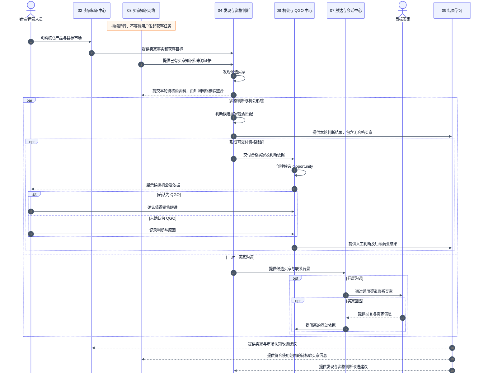
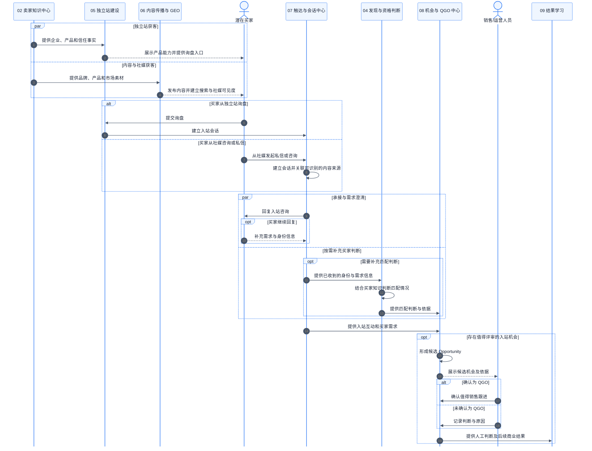
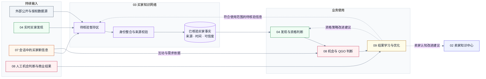
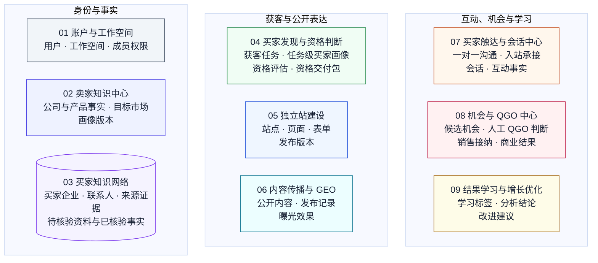
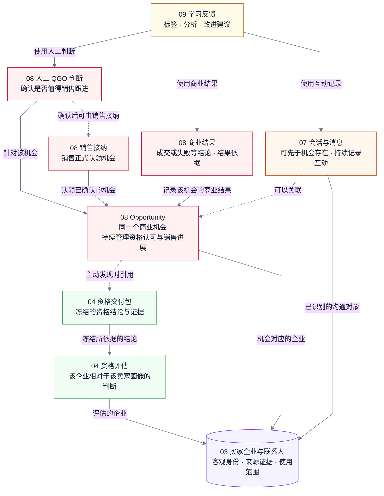

# Global 产品总设计

> 文档 ID：`DOC-PRODUCT-DESIGN-001`
> 生命周期：`CURRENT`
> 维护 Owner：`OWN-PRODUCT`（具体人员与模块分工由责任表承接）
> 最近实质更新：2026-10-27
> 适用范围：整个 Global 产品的目标、模块职责、核心业务对象和跨模块协作。
> 当前事实来源：[产品范围与本仓边界](product-scope.md)、[当前架构](architecture/current.md)、[ADR/PDR 注册表](adr/registry.md)、[当前状态](status/current.md)及[发布路线](roadmap/release-plan.md)。
> 文档规则：[文档目录与维护规则](documentation-rules.md)。
> 来源承接：原工作区根目录 `global-backend-product-logic-guide.md`，本次整体迁移至 `docs/product.md`。

本文件是整个产品总设计的统一入口，定义产品目标、九个模块、核心业务对象归属和跨模块协作，作为各模块 `product.md` 的共同依据。第四章集中定义对象边界；第三章流程图及模块子文档应与其一致。模块产品总设计的写法见[统一模板](shared/templates/product.md)。本文聚焦产品逻辑，具体技术实现由模块技术方案承接。

`CURRENT` 表示本文件是当前维护的产品总设计，不代表全部目标已经实现、全部提案已经批准或用户已经可用。第七章的未决项继续保留，确认前不能作为已定实现要求；其他新评审意见也不因本次迁移自动生效。跨模块调整由工作群讨论决定，再同步总设计、流程图和受影响模块文档。

本文描述完整产品的目标结构，不扩大当前后端仓库的实现职责。本仓边界与现行承重决定仍按上列产品范围、代码、机器合同和 ADR 执行；实现、验证与验收情况统一查阅当前状态，建设顺序查阅发布路线。相关产品细节参考[用户旅程](frontend/03-users-roles-and-journeys.md)、[能力登记](governance/capability-register.md)和[建站 PRD](site-builder/01-prd.md)。GoodJob 仅作为 CRM 定位对照，来源为用户提供的[会话快照](https://chatgpt.com/s/cx_6aa4e9fd765081918c57258ae860c2c2)。

## 变更历史

| 日期 | 主要变更 | 原因 | 影响范围 | 确认来源 |
| --- | --- | --- | --- | --- |
| 2026-10-27 | 将根目录产品逻辑稿整体迁移为 `docs/product.md`，补齐总设计定位、文档信息与来源记录；修正相对链接，将时间敏感状态改为引用集中状态页 | 按统一目录规则建立整个产品的总设计入口 | 文档角色、路径、入口与引用；保留九模块、对象定义、业务图及现有待决项 | 产品负责人本次明确要求升级并移动文档 |

## 阅读前：核心术语

本文及后续模块子文档使用以下定义。“客户”仅指购买和使用本平台的卖家企业；海外采购方统一称“买家”。图中的模块编号对应第二章的九个产品模块。

| 术语 | 统一定义 | 负责模块 |
|---|---|---|
| **卖家** | 使用平台寻找买家的企业；用户账号与卖家企业资料分别管理 | 企业资料属 02，账号属 01 |
| **用户** | 卖家工作空间内使用平台的个人，其身份和权限与卖家企业资料分别管理 | 01 |
| **卖家画像** | 对卖家公司、产品、能力、品牌和目标市场的有依据描述；可以形成后续版本 | 02 |
| **目标市场** | 卖家希望开展业务的国家或区域，是买家发现的输入条件 | 02 |
| **买家企业** | 可能采购产品的真实组织，其身份与客观事实独立于某位卖家的匹配判断 | 03 |
| **联系人** | 与买家企业有关联的个人及其角色、联系方式和来源证据；是否适合特定卖家联系由资格判断决定 | 03 |
| **买家画像 / ICP** | 希望发现的理想买家特征，由卖家产品、目标市场和业务目标形成；与某家实际买家企业的资料不同。长期版本与单轮使用快照的归属待第七章确认 | 本蓝图暂由 04 形成任务级画像，引用 02 的卖家输入 |
| **候选买家 / Candidate** | 主动发现或被动进入、尚待该卖家目标下资格判断的买家企业；其企业身份事实仍由模块 03 管理 | 04 管理本轮候选关系；03 管理企业身份 |
| **资格评估 / Lead** | 某买家企业相对于某卖家、某一版买家画像的评估对象，包含匹配、需求、可信度、可联系程度和理由；未达到交付条件的评估仍是评估 | 04 |
| **资格交付包 / LeadQualifiedPackage** | 模块 04 对合格买家的判断及依据，是当前获客后端向 SaaS 交付的结果；交付后保留当时的判断 | 04 形成；08 使用其依据 |
| **候选机会 / Opportunity 的 CANDIDATE 状态** | 有依据、等待人工判断是否值得销售跟进的机会；可由主动发现或入站互动提出，与模块 04 的候选买家不是同一对象 | 08 |
| **机会 / Opportunity** | 属于某工作空间、关联某买家及明确卖家业务目标的单一商业对象；持续承载资格认可、销售接纳和商业进展 | 08 |
| **QGO** | 经过人工确认、值得销售跟进的合格增长机会，是同一个 Opportunity 的资格认可，不创建另一套机会对象 | 08 |
| **销售接纳 / SAO** | 销售正式认领机会并开始负责推进；与 QGO 资格认可分别记录，沿用现有产品范围中的术语 | 08 |
| **会话 / Conversation** | 某渠道中与买家发生的一段沟通及其消息记录，可以在机会形成之前存在 | 07 |
| **商业结果 / CommercialOutcome** | 机会后续产生的成交、失败或其他明确结果及其依据 | 08 |
| **学习反馈** | 从资格结论、人工决策、互动和商业结果中提取的标签、分析及改进建议 | 09 |
| **GEO** | 使卖家的公开内容更容易在生成式引擎回答中被发现和准确引用的内容可见度优化 | 06 |

## 一、产品要解决的核心问题

目标客户是中国 B2B 制造、工贸一体和高客单出口企业。购买决策者通常是老板或出海负责人，日常操作者包括海外增长、外贸运营、品牌内容人员和销售。

卖家需要解决的不是单一的“找公司”问题，而是一条连续的增长链路：

1. 清楚表达自己卖什么、面向哪个市场；
2. 找到可能购买这些产品的海外企业；
3. 判断哪些企业真正匹配、为什么值得现在跟进；
4. 找到合适联系人并发起一对一沟通；
5. 用独立站、内容和社媒建立可信的入站渠道；
6. 汇集主动发现和被动进入的买家信息，形成有依据的候选机会；
7. 用人工 QGO 判断、销售接纳、沟通和真实商业结果改进下一轮增长。

因此，完整产品可以概括为：

> **以卖家知识和买家知识为基础，同时运行主动获客与被动获客两条路径，形成经人工确认的 QGO，再由销售接纳与推进，并通过真实结果持续学习。**

首批使用前提已经明确：卖家负责提供**核心产品和目标市场**。平台负责将这些输入转化为买家判断和增长行动，而不是要求卖家先成为买家研究专家。

上述能力并非固定串行执行；主动获客、独立站、内容传播和买家沟通可以并行协作。

## 二、九个产品模块

模块以独立的用户结果或长期后台能力划分。一个模块可以对应 SaaS 主站中的一个或一组相关页面，也可以作为无需直接交互的独立服务存在。

| 编号 | 产品模块 | 核心职责 | 主要产出 | 产品形态 |
|---|---|---|---|---|
| **1** | **账户与工作空间** | 管理用户、企业工作空间、团队关系和使用权限 | 可安全使用产品的组织空间 | SaaS 基础模块 |
| **2** | **卖家知识中心** | 持续管理卖家的公司、产品、目标市场、能力、品牌和经营事实 | 可供所有增长模块复用的卖家画像与产品知识 | 用户交互模块 |
| **3** | **买家知识网络** | 持续从多渠道获取、整合、核验、更新买家企业及其产业、采购和联系人信息 | 可复用、可追溯、持续丰富的买家知识资产 | 后台独立服务 |
| **4** | **买家发现与资格判断** | 根据卖家产品和目标市场主动发现候选，也可使用模块 3 的企业身份资料评估入站买家；形成任务级买家画像，判断匹配、需求、可信度和可行动性 | 候选买家、资格结论、判断理由及资格交付包 | 买家判断模块 |
| **5** | **独立站建设** | 把可信的卖家知识转化为面向海外买家的企业与产品展示 | 可持续维护的海外独立站及询盘入口 | 被动获客模块 |
| **6** | **内容传播与 GEO** | 基于卖家知识形成宣发内容，提升搜索与生成式引擎可见度，并进行多社媒发布和效果观察 | 公开内容、渠道曝光与入站来源信息 | 被动获客模块 |
| **7** | **买家触达与会话中心** | 对买家开展邮件、WhatsApp、社媒私信等一对一沟通，并统一承接站点询盘、社媒私信和后续会话 | 买家沟通、入站询盘、会话及互动结果 | 互动执行模块 |
| **8** | **机会与 QGO 中心** | 汇聚主动发现和被动进入的机会依据，由人确认哪些机会值得销售跟进，并记录销售接纳与商业结果 | 候选机会、人工确认的 QGO、销售接纳及商业结果 | 商业机会模块 |
| **9** | **结果学习与增长优化** | 汇总接纳、拒绝、传播、沟通、成交和失败结果，识别判断偏差并提出改进建议 | 学习标签、分析结论及面向知识与增长执行的改进建议 | 学习与洞察模块 |

这次收敛包含三项重要调整：

- 原“信息录入”和“卖家知识库更新”管理同一类产品对象，合并为**卖家知识中心**；
- 原“买家画像、获客、数据库、实时获取和 AI 评分”职责过大，拆为后台的**买家知识网络**与面向具体任务的**买家发现与资格判断**；
- GEO 归入内容传播；真实商业结果由机会中心记录，结果学习模块据此形成分析与改进建议。

## 三、九个模块如何形成完整闭环

本章用四张图分别说明产品结构、主动获客、被动获客和知识反馈。流程中的箭头表示业务协作或信息传递；对象的唯一负责模块见第四章。一个对象被其他模块使用后，仍由原负责模块管理。

### 3.1 产品结构总览

这张图只表达模块怎样组成产品，不表达每一次业务执行的严格时间顺序。账户与工作空间是所有用户功能的共同底座；卖家知识和买家知识是共享知识层；主动发现与入站互动都向机会中心提供依据，资格判断和买家沟通可以并行。

### 3.2 主动获客时序

本图展示发现候选买家后，资格判断与一对一沟通可以并行。模块 4 对合格买家提供判断依据，模块 8 形成候选机会并交由人判断是否成为 QGO；没有合格买家也是真实的本轮结果。模块 7 的沟通不以 QGO 为开关。

### 3.3 被动获客时序

被动路径的入口是独立站、公开内容和社媒互动。模块 7 承接入站沟通，模块 4 可以补充买家匹配判断；模块 8 汇集入站需求与已有依据，提出值得人工评审的候选机会。入站机会不以模块 4 产出资格交付包为统一前置条件。公开社媒内容属模块 6，社媒私信的接收与回复属模块 7。

### 3.4 买家知识与结果学习飞轮

买家知识网络的价值不只是预先拥有一批企业数据。它持续吸收外部来源、实时发现和真实商业结果，并明确区分“待核验信息”“已核验事实”和“面向具体卖家的判断”。这样，每次服务卖家都可能增加平台知识，但卖家私有事实与可复用事实不会被混为一体。

共享知识支持主动与被动获客，两条路径都向同一个机会中心提供判断依据；会话承载互动，QGO 表达人工确认，真实结果为下一轮增长提供改进依据。

## 四、核心业务对象与模块边界

### 4.1 对象归属的统一规则

本章定义目标产品中由哪个模块负责维护各类业务事实与判断。其他模块可以使用这些信息，但不因此改变其归属。模块归属不等同于页面位置或服务部署方式。

一个机会显示在会话页面上，仍由模块 8 管理；一份买家资料出现在机会详情中，仍由模块 3 管理。判断、沟通和学习可以同时发生，对象的负责模块不会随流程推进而移交。

卖家的业务记录归属相应工作空间，模块 1 管理访问身份与权限。模块 3 可以维护符合使用范围的平台共享买家事实，也要区分卖家私有信息；来源得到核验，不等于允许跨卖家共享。

### 4.2 九模块对象归属总览

颜色表示唯一负责模块；同一模块在本章各图中使用同一种颜色，模块编号和文字同时标明归属。本图只展示每个模块维护的对象，模块之间的对象关系见 4.3，业务执行顺序见第三章。完整职责以表格为准。

| 唯一负责模块 | 核心对象 | 对象含义与维护范围 | 对其他模块提供什么 |
|---|---|---|---|
| **01 账户与工作空间** | 用户、工作空间、成员关系与使用权限 | 谁在什么组织中、可以访问和使用哪些能力 | 身份、组织上下文与访问权限 |
| **02 卖家知识中心** | 卖家公司、产品、能力、品牌、目标市场及画像版本 | 卖家提供什么产品、面向哪里，以及这些表述的事实依据 | 供研究、建站和内容使用的卖家事实与版本 |
| **03 买家知识网络** | 买家企业、联系人、产业与采购事实、来源证据、待核验知识记录 | 买家是谁、已知事实是什么、从哪里来、什么时候核验、允许如何使用 | 有来源、有时效和使用范围的买家知识；暂存资料有明确待核验标记 |
| **04 买家发现与资格判断** | 获客任务、任务级买家画像、候选评估、评分与资格结论、资格交付包 | 这轮为哪个卖家、哪些产品和市场找买家；某企业为何匹配、有哪些未知项 | 候选买家与资格判断；符合交付条件时输出不可变 `LeadQualifiedPackage` |
| **05 独立站建设** | 站点、页面、表单与发布版本 | 把卖家知识呈现为可信的站点内容，并提供询盘入口 | 可访问的站点、询盘入口及站点来源信息 |
| **06 内容传播与 GEO** | 公开内容资产、渠道发布记录与传播效果 | 一对多表达了什么、在哪里公开发布、获得何种可见度与互动 | 内容与公开传播效果；供会话和机会关联的内容来源 |
| **07 买家触达与会话中心** | 一对一沟通、入站询盘、会话及互动记录 | 与哪个买家通过什么渠道沟通，对方表达了什么需求 | 沟通事实、需求澄清与跟进反馈 |
| **08 机会与 QGO 中心** | 候选机会、人工 QGO 判断、销售接纳与商业结果 | 哪个买家值得销售跟进、销售是否接手、后续结果如何 | 经确认的 QGO、销售跟进信息与商业结果 |
| **09 结果学习与增长优化** | 学习标签、聚合分析、判断偏差与改进建议 | 从研究、传播、沟通和商业结果中得到哪些可复用经验 | 对模块 2、3、4、5、6、7 的改进建议与待核验的新信息 |

模块 4 可以暂存本轮实时获取的原始资料，暂存资料仍属于任务输入；交给模块 3 后，模块 3 负责其知识核验、整合和长期维护。任务暂存与知识入库不能被当作两套独立的买家主档案。

### 4.3 核心对象关系

下图使用文首术语，聚焦商业闭环中的对象关系。实线表示评估、依据或结果关联，虚线表示只在相应路径中出现的关联。颜色仍表示对象的负责模块；这些箭头不表示对象依次改变类型或归属。

QGO、销售接纳和商业结果都由模块 8 管理；会话由模块 7 管理，学习反馈由模块 9 管理。QGO 只表示人确认该机会值得销售跟进，销售正式接手仍是后续独立动作。具体记录方式由模块子文档定义。

### 4.4 关键协作边界

#### 买家事实与卖家匹配判断（03 / 04）

模块 3 管理企业身份、产业与采购事实、联系人和来源可信度；模块 4 判断这些信息对于某个卖家和本轮目标意味着什么。同一家企业可以同时匹配卖家 A、不匹配卖家 B，评估差异不应覆盖企业主档案。买家网络持续运行；单轮交付完成后，修改卖家产品、目标市场或买家画像需要发起新一轮获客，历史评估和交付快照保持原始依据。

#### 卖家知识与衍生内容（02 / 05 / 06）

模块 2 管理公司与产品事实，模块 5、6 管理基于这些事实形成的站点和公开内容。调整公开表达不应直接改写卖家事实；卖家事实更新后，由对应模块决定如何更新站点或内容，已经交付的买家判断保留原有依据。

#### 公开传播与定向互动（05 / 06 / 07）

模块 5 管理站点与表单入口，收到的询盘由模块 7 建立和维护会话。模块 6 管理公开内容和传播效果；邮件、WhatsApp、社媒私信等针对明确买家的互动归模块 7。社媒私信可以关联模块 6 的内容来源，但其消息记录和后续回复由模块 7 管理。

#### 资格交付与商业机会（04 / 08）

主动发现时，模块 4 向模块 8 提供合格买家及判断依据；入站互动也可以向模块 8 提供机会依据。模块 8 汇集这些信息，形成人工评审的候选机会。只有人确认值得销售跟进，才成为 QGO；机器评分、交付包或买家回复都不自动产生 QGO。同一商业机会的后续信息应继续关联该机会，不因信息再次到达就产生另一项机会。

#### 会话与机会（07 / 08）

模块 7 管理买家沟通，模块 8 在判断机会时可以使用其中的需求和互动信息。沟通可以发生在机会形成之前，也可以在形成之后持续；是否成为 QGO 仍取决于依据和人工确认。模块 3 负责识别、整合买家企业身份，模块 7 不另建买家企业档案。

#### QGO 与买家触达（08 / 07）

QGO 是模块 8 对机会价值的人工确认。模块 7 负责买家触达与会话；沟通信息可以成为机会判断的依据，确认后的机会也可以供销售继续跟进。QGO 不自动发起触达，也不是触达的统一前置条件。平台代用户发送消息仍须使用已获授权的渠道；本文不增加逐买家或逐条发送的业务审批。

#### 商业事实与结果学习（08 / 09，及 02 / 03 / 04）

模块 8 保存人工决策、商业进展和成交等结果，模块 9 使用这些结果和模块 7 的互动事实形成学习标签与建议。模块 9 不另建一套机会、交易或会话主记录。对卖家知识、买家知识、资格策略或传播与触达策略的改进，由对应负责模块判断并维护新版本；学习结论不会直接覆盖历史事实。用户对话中新出现的信息先保留来源和待核验属性，卖家事实回到模块 2，买家事实交给模块 3 核验；只有允许共享的信息才能进入平台可复用知识。

### 4.5 后续模块子文档的拆分约束

各模块子文档必须写明：本模块维护的对象、读取的外部对象、输入与输出、更新其他模块时采用的协作方式，以及本模块的验收结果。第三章用于检查业务路径完整性，本章用于检查对象责任的一致性。

不能在另一模块中新建同义业务对象或独立维护外部对象状态。需要调整归属、改变 QGO 含义或增加跨模块前置条件时，先修订本章，再同步相关流程图与子文档。详细字段、状态机和交互规则由子文档展开；第七章的未决产品事项在确认前保留为明确的未决项。

## 五、产品注重什么、选择舍弃什么

产品重点建设五类能力：

1. **增长闭环**：主动获客和被动获客都能提供可判断的买家信息，有依据的机会经人工确认后形成 QGO；
2. **知识积累**：每轮获客和真实结果都能提出新的知识线索，经核验后完善卖家或买家知识；
3. **机会质量**：匹配、需求、可信度、可联系程度和人工 QGO 判断共同决定价值；
4. **可信表达**：推荐理由和公开内容能够说明来源、时间、限制和未知项；
5. **人机责任清晰**：系统提供研究与建议，人确认 QGO 等关键商业判断。

产品不应依靠以下方式制造表面成果：

- 用海量未经核验的名单代替合格机会；
- 用曝光量、发布量或消息发送量代替商业结果；
- 将找不到联系人误判为企业不匹配；
- 将系统评分直接等同于 QGO；
- 为完成交付数量而隐藏“本轮没有合格机会”的真实结果。

GoodJob 的对照价值在于说明 CRM 侧重销售接手后的买家关系、跟进和成交管理。九模块蓝图吸收了触达、会话和机会管理，但仍把买家知识、机会判断和可信来源作为差异化重心，不以复制完整通用 CRM 为产品目标。

## 六、与现有仓库文档的冲突及处理

新的九模块蓝图与原文档的**核心价值叙事一致**：都以有证据的买家机会、人工 QGO 和真实结果反馈为目标；独立站继续作为并行的信任与入站获客路径。

同时存在以下边界差异，必须明确保留：

| 差异 | 当前仓库权威边界 | 九模块目标蓝图 | 本文处理方式 |
|---|---|---|---|
| 触达、会话与商机 | 当前 `global-backend` 仓库止于 `LeadQualifiedPackage`；触达、Conversation、Opportunity/QGO 归外部 SaaS | 完整产品包含模块 7 和模块 8 | 将它们作为完整产品模块，不宣称由当前仓库实现 |
| 社媒传播与 GEO | 当前 MVP 未提供 Campaign、内容发布和多渠道执行 | 目标产品包含模块 6 | 作为目标能力保留，当前状态仍是后续建设 |
| 买家知识网络 | 当前资料分散在 Buyer Intelligence 的采集、身份、证据和信号能力中 | 将其提升为独立战略模块 | 这是产品模块重构建议，尚未改变现有仓库 ownership |
| 买家画像 / ICP | 当前[产品范围](product-scope.md)将长期 `ICPVersion` 归 SaaS Growth Strategy | 模块 4 负责形成和使用本轮任务级买家画像 | 长期画像与单轮快照的归属尚未对齐；确认前不得据此迁移现有对象责任 |

因此，本文同时采用两层视角：

- **目标产品层**：九个模块共同构成完整海外增长产品；
- **当前仓库层**：现阶段主要拥有买家智能和独立站后端，其他模块由 SaaS 或未来产品建设承接。

“资格交付包 → Opportunity → 人工 QGO → 结果反馈”定义产品的目标主路径；触达、会话与这条路径协作，但不以 QGO 为统一开关。该主路径及独立站公开发布、询盘和正式用户体验的实际完成情况统一查阅[当前状态](status/current.md)及对应验收证据，本页不复制时点读数。目标设计用于指导产品方向，不能替代当前实现、运行或用户验收证据。

## 七、仍需在产品层决定的问题

以下问题会影响模块边界、能力顺序或具体交互；确认前不能作为已定实现要求：

### 7.1 原有产品待决问题

1. 首版以主动获客、独立站还是两者组合为主要销售入口；
2. QGO 之后，模块 8 对销售跟进和结果记录的产品范围到哪里；
3. 多社媒公开传播与一对一定向触达各自支持哪些首发渠道；
4. 真实成交结果通过用户回写、系统集成还是托管运营获得；
5. 买家知识网络对卖家私有信息、共享事实和系统推断采用怎样的产品级边界；
6. 长期买家画像 / `ICPVersion` 与单轮任务级画像分别由谁维护。

### 7.2 与旧版总纲的差异及待对齐问题

登记日期：2026-10-25。对照来源为[《顶层产品与系统架构设计 v1.0》](platform/全球客户开发与增长执行平台_顶层产品与系统架构设计_v1.0.docx)。该 Word 是 2026-07-10 入库、封面标注“待批准”的历史上游材料；以下分别登记两项明确冲突与三项待对齐内容，不将它们视为同一种问题。

| 项目 | 性质 | 旧 Word 总纲 | 本文九模块总纲 | 需要确认或对齐的问题 |
| --- | --- | --- | --- | --- |
| Lead 的含义 | 明确冲突 | §2.3、§6.4 将 Lead 定义为用户或规则接受后，进入工作队列或 Audience 的正式业务线索 | 文首术语表将 Lead 定义为某买家针对某卖家、某版 ICP 的资格评估对象，尚未合格或尚未被接受也可以存在 | 统一对象含义、创建时机与责任；明确旧稿“接受后的正式线索”如何映射到当前对象，避免两种 Lead 语义混用 |
| QGO、SAO 与 Opportunity 模型 | 明确冲突 | §4.2、§4.3 将 QGO 归会话资格域，SAO 与 Opportunity 归商机域，按不同对象衔接 | 模块 8 统一维护 Opportunity，QGO、销售接纳与商业结果围绕同一机会记录；模块 7 维护会话 | 明确沿用当前单一 Opportunity 聚合口径，并记录旧对象拆分方案的替代关系；如主张变更，须另行形成跨模块决定 |
| ICP 归属 | 待对齐 | §4.2 将 ICP 放在买家智能域，§6.3 又将其列入平台业务核心，表述尚未统一 | 模块 4 形成和使用任务级画像，长期 ICP 与单轮快照的归属仍待决定 | 与第 7.1 节第 6 项合并讨论：区分长期画像、版本与单轮快照，明确各自负责模块及更新关系 |
| 外部动作授权粒度 | 待对齐，尚不能认定互斥 | §3.4 统一强调 Policy、Approval 与 ExecutionAuthorization；§7.3–§7.5 同时允许人工或预授权，未明确所有动作均须逐条人工审批 | 第 4.4 节强调有效渠道授权，不增加逐买家或逐条发送的业务审批 | 明确渠道、批次与单次动作的授权及审批粒度，说明两种表述如何兼容；不能据旧稿机械增加逐条审批，也不能据本文省略现行授权要求 |
| 建设顺序 | 规划口径待对齐 | TA-010、§10.2 建议获客后先做 Campaign、邮件，再做 Inbox、QGO 与 Outcome | 第 7.1 节第 1 项仍保留首发入口的选择，整体业务流程支持主动获客、被动获客与沟通并行协作 | 区分产品允许的协作关系与实际建设先后；首发选择在此确认，实施优先级回写发布路线，旧顺序不自动成为当前计划 |

其中，Lead 定义与单一 Opportunity 聚合在[当前 ADR/PDR 注册表](adr/registry.md)已有口径，本次登记不因重新发现旧稿而自动重开已采纳决定。其他已被现行决定替代的旧案，也应补齐承接与替代说明；真正需要改变共同边界的提议再提交工作群讨论。确认前继续遵循仓库现有产品范围、ADR 与发布路线，不据本节修改对象归属、权限或实现责任。

旧稿的 14 个领域与本文九模块，数量不同本身不构成冲突；独立站在本文中成为明确模块，主要属于覆盖范围和组织方式的调整，不单独列为冲突项。

对齐完成后，将结论回写术语表、第四章对象边界和相关流程，并保留决定来源及旧条款的承接关系。本次补充仅登记差异与待决问题，不改变前述正文定义，也不代表已经裁决上述差异。
