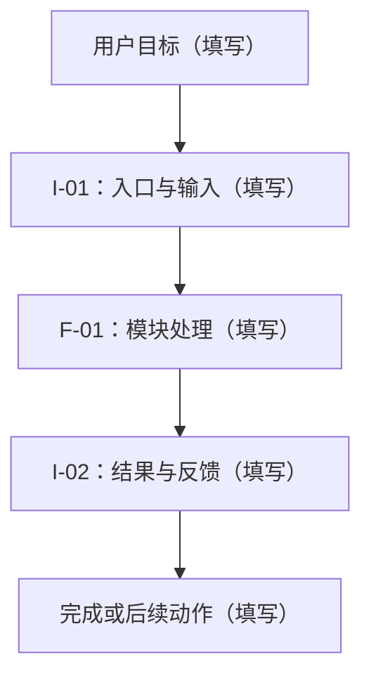
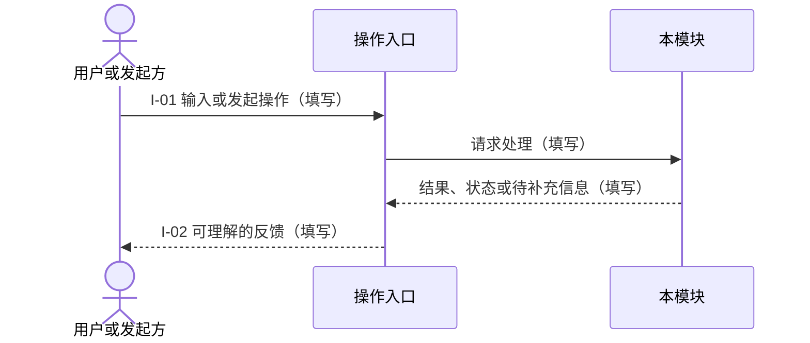

# 模块产品总设计模板

> 文档 ID：`DOC-TEMPLATE-MODULE-PRODUCT-001`
> 生命周期：`TEMPLATE`
> 用途：统一各模块 `product.md` 的结构，供产品评审、模块协作和后续 AI 设计与开发使用。
> 目录依据：[文档目录与维护规则](../../documentation-rules.md)。

使用时复制到 `docs/modules/<模块名>/product.md`，将标题改为模块名称，替换为唯一文档 ID，并将生命周期改为实际状态。未确认的设计使用 `DRAFT`；成为当前设计基线后按现有规范使用 `CURRENT`。模板自身的状态、占位文字和示意图不代表任何模块已经确认、实现或验收。

保留以下八个章节。将所有“【填写】”替换为实际内容；不适用的部分写明原因，资料不足的部分说明缺口及其影响。第 4 节描述模块整体流程，第 5 节按子功能集中组织详细产品设计，第 7 节维护整体 AC 和功能 AC 索引。详细技术实现写入模块 `technical.md`。

默认在主文档内按子功能分节；复杂子功能按第 5 节的规则拆为模块目录下的 `<专题>.md`。每个功能的流程、规则、状态和 AC 尽量放在同一位置，使人类能够集中审核、AI 能够完整理解。

## 文档信息

| 项目 | 内容 |
| --- | --- |
| 模块名称 | 【填写】 |
| 模块一句话职责 | 【填写：为谁解决什么问题，交付什么结果】 |
| 产品负责人 | 【填写实际人员；未指定时明确写待指派】 |
| 技术负责人 | 【填写实际人员；未指定时明确写待指派】 |
| 最近实质更新日期 | 【填写】 |
| 上层总设计 | 【填写有效文档及相关章节的相对链接】 |
| 模块技术方案 | 【填写相对链接；尚未建立时说明】 |
| 项目进度与验收记录 | 【填写相对链接，供查询实现情况和验收证据】 |
| 其他必要依据 | 【填写公共规范、已确认决定或专项文档的相对链接】 |

用一小段话概述本模块的用户、主要输入、核心行为、输出，以及在整个产品中的位置。概览只概括正文，不另行定义一套规则。

文档生命周期说明这份文档的有效性；对象业务状态写在第 5 节或其引用的功能专题中；模块级未决设计集中写在第 8 节；实际开发、验证与验收情况由项目进度和验收记录维护。`CURRENT` 不等于功能已实现或已通过验收。

## 1. 变更历史

记录本主文档的主要设计变更，说明原因、影响和确认来源。本文定义的流程、交互点、AC 或重要边界发生变化时，必须更新本表；普通措辞修正不必逐条登记。已拆为专题的功能，其局部变化记录在专题变更表；影响模块整体或其他功能时，同步本表。

| 日期 | 主要变更 | 原因 | 影响的流程、AC 或边界 | 确认人或决定来源 |
| --- | --- | --- | --- | --- |
| 【填写】 | 【填写】 | 【填写】 | 【填写稳定编号或章节】 | 【填写人员与可追溯来源】 |

已确认结论直接更新对应正文。未确认的建议先进入第 8 节，不以变更记录代替决定，也不将历史规则与当前规则并列执行。

## 2. 模块定位与边界

### 2.1 用户与目标

- 服务用户或调用方：【填写】。
- 要解决的问题：【填写用户遇到的问题及其业务影响】。
- 期望结果：【填写用户可感知、可验证的结果】。
- 在整体产品中的责任：【填写与上层总设计的关系】。

### 2.2 负责范围

| 范围 | 本模块负责的内容 | 输出或完成条件 |
| --- | --- | --- |
| 当前设计覆盖 | 【填写已确认的功能范围】 | 【填写】 |
| 后续范围 | 【填写已明确后置的方向，或说明暂无】 | 【填写进入后续设计的条件】 |

这里描述设计范围。实际完成程度通过“文档信息”中的项目进度链接查询。

### 2.3 明确不做什么

| 明确不做什么 | 原因 | 由谁承接或如何处理 |
| --- | --- | --- |
| 【填写】 | 【填写】 | 【填写责任模块、替代路径或明确不提供】 |

与 AI 讨论形成的新边界，确认采用后更新本表。涉及模块归属或共同规则的变化，按工作群讨论机制决定后同步上层总设计；尚未确认的调整写入第 8 节，并说明期间沿用的规则。

## 3. 术语与核心对象

### 3.1 术语表

| 术语 | 统一定义或上位定义链接 | 本模块使用说明 |
| --- | --- | --- |
| 【填写】 | 【填写】 | 【填写必要限定、易混淆点或同义词】 |

同一概念统一命名。全局已有定义时引用其唯一来源，补充本模块的适用说明；局部新术语在本表定义。英文名称、缩写和中文名称之间的对应关系需明确。

### 3.2 核心对象与责任

| 对象 | 业务含义 | 负责模块 | 本模块维护什么 | 引用或更新其他模块对象的方式 |
| --- | --- | --- | --- | --- |
| 【填写】 | 【填写】 | 【填写】 | 【填写，或明确只读引用】 | 【填写，或说明不涉及】 |

区分本模块拥有的对象与从其他模块使用的对象，避免重新创建同义对象或维护另一份主状态。详细字段、数据库表和接口 Schema 由技术方案及机器合同定义。

## 4. 用户流程与交互设计

本节表达模块整体的稳定交互及跨子功能关系，包括用户目标、操作入口、交互点、系统反馈、关键分支与结束条件。子功能内部的详细流程与交互写在第 5 节对应功能中，或由该节链接其专题，不在两处重复维护。后台模块可以使用发起方、调用入口和接收方表达交互，不编造实际不存在的页面。

### 4.1 主要场景

| 场景 | 用户或调用方目标 | 入口与前置条件 | 完成结果 |
| --- | --- | --- | --- |
| 【填写】 | 【填写】 | 【填写】 | 【填写】 |

### 4.2 流程图

以下仅示意绘图方式，使用时须替换为真实流程。图中应表达影响产品结果的条件分支，并在适用时说明失败、取消、等待确认及恢复路径。

### 4.3 交互图与交互点

交互图说明参与者之间的动作与反馈。模块内部组件、网络调用和持久化步骤由技术方案展开。

| 交互点 | 用户或调用方动作 | 系统反馈与可继续的动作 | 关联功能和 AC |
| --- | --- | --- | --- |
| I-01 | 【填写】 | 【填写】 | 【填写】 |
| I-02 | 【填写】 | 【填写】 | 【填写】 |

图、交互点、功能和 AC 使用模块内稳定编号，便于引用与变更追踪；已有正式编号时沿用原编号，无需另建全局登记表。正文、图和交互点表必须表达同一套行为。

AI 可以提出调整建议，但不能因实现便利自行改变已确认的交互。调整经模块负责人确认；涉及跨模块关系时按工作群讨论机制决定，并更新变更历史与关联 AC。

## 5. 子功能设计

### 5.1 功能目录与共用规则

| 功能编号 | 功能名称与职责摘要 | 与其他功能的关系 | 详细设计唯一位置 |
| --- | --- | --- | --- |
| F-01 | 【填写】 | 【填写依赖、衔接或独立关系】 | 【填写本文章节或专题相对链接】 |

模块共用的术语、对象归属和边界在第 2、3 节定义；模块级共用规则与状态在本节或关联公共规范中定义一次，子功能引用并补充差异。

默认使用下面的子功能结构，按实际功能复制为 F-02、F-03 等独立小节。存在以下情况时，可将该功能的完整设计拆到模块目录下的 `<专题>.md`：

- 有独立且复杂的流程、交互、状态和 AC，需要单独评审。
- 详细图表已经影响主文档的整体阅读。
- 由不同人员持续并行维护，需要独立修改。

专题写明所属模块、功能编号、负责人、上位文档和文档生命周期，保留功能完整设计、局部待决问题与主要变更记录。主文档对应小节保留职责摘要、功能关系和专题链接，第 7 节引用其 AC。专题中的产品设计与技术设计应明确用途；技术实现仍由模块 `technical.md` 或其技术专项承接。

例如，`modules/site-builder/` 可以按需增加 `build-and-recovery.md`，与 `product.md`、`technical.md` 同级；这个示例不要求立即创建文件或新的目录层级。

拆分时每个功能只有一个详细设计来源，功能编号和 AC 编号保持稳定；专题局部变化记录在专题变更表，影响模块整体或其他功能时同步主文档。主文档与专题相互引用，不复制同一套详细正文。

### 5.2 F-01 子功能名称

以下五部分构成一个完整的子功能设计。简单功能可以短写；复杂功能拆为专题后，将本节替换为职责摘要、功能关系和详细设计链接。

#### 目标与边界

- 解决的问题与期望结果：【填写】。
- 本功能负责什么：【填写】。
- 本功能明确不做什么：【填写局部边界；模块共用边界引用第 2 节】。
- 与其他功能的关系：【填写】。

#### 输入与输出

| 方向 | 内容 | 提供方或接收方 | 前置条件或完成条件 |
| --- | --- | --- | --- |
| 输入 | 【填写】 | 【填写】 | 【填写】 |
| 输出 | 【填写】 | 【填写】 | 【填写】 |

跨模块协作引用第 6 节的共同约定，只补充该功能的具体使用方式。

#### 流程与交互

【填写本功能的用户操作、系统反馈、关键分支和结束条件；按需添加局部流程图、交互图及交互点表。图表格式参考第 4 节，不复制其整体流程。】

使用稳定交互点编号，将局部交互与第 4 节的整体流程关联。涉及失败、取消、等待确认和恢复时，说明产品期望的处理方式。

#### 规则与状态

| 对应场景或交互点 | 前置条件 | 处理规则与执行者 | 结果 | 条件不满足或异常时 |
| --- | --- | --- | --- | --- |
| 【填写】 | 【填写】 | 【填写可据此判断的规则】 | 【填写】 | 【填写】 |

| 对象 | 原状态 | 触发动作及条件 | 新状态 | 执行者 | 拒绝或失败时 |
| --- | --- | --- | --- | --- | --- |
| 【填写】 | 【填写】 | 【填写】 | 【填写】 | 【填写】 | 【填写】 |

规则应明确触发条件、允许的行为和可观察结果。仅定义本模块负责的业务状态，共用状态和其他模块的状态引用其唯一来源；与当前机器合同存在差距时明确指出，技术方案说明实现安排。没有独立状态机时说明原因。

如果功能涉及 AI，在这里说明以下内容；不涉及则明确写明：

- AI 可以生成、判断或建议什么：【填写】。
- 哪些事实需要来源或其他依据：【填写】。
- 哪些行为由确定性系统执行：【填写】。
- 哪些结果按已确认规则需要人确认：【填写；不因套用模板额外增加审批】。
- 信息不足、依据冲突或无法判断时如何反馈与处理：【填写】。

#### 功能 AC

| AC 编号 | 对应交互点 | 前置条件与操作 | 必须满足的产品结果 |
| --- | --- | --- | --- |
| AC-F01-01 | 【填写】 | 【填写在什么情况下执行什么操作】 | 【填写应出现及不应出现的行为、结果或状态】 |

在本节维护本功能 AC 的唯一正文，第 7 节只建立引用。编号须在模块内唯一；`AC-F01-01` 仅为示例，已有 AC 沿用原编号，不因拆分文件重新编号。

## 6. 模块协作

| 方向 | 协作模块 | 输入或输出的业务内容 | 触发与使用条件 | 归属、更新与反馈方式 | 缺失或失败时 |
| --- | --- | --- | --- | --- | --- |
| 输入 | 【填写】 | 【填写】 | 【填写】 | 【填写】 | 【填写】 |
| 输出 | 【填写】 | 【填写】 | 【填写】 | 【填写】 | 【填写】 |

写清交付内容的业务含义、责任、时机与后续动作。接口字段、事件 Schema、重试和幂等实现由技术方案及机器合同展开，本文引用其位置。

涉及多个模块的规则以总设计或公共规范为共同依据。本模块文档说明具体使用方式；发现冲突时在第 8 节记录主张、影响和现行处理方式，提交工作群讨论。

## 7. 整体 AC 与功能 AC 索引

AC 定义必须满足的产品结果，是产品准入、评审和验收的重点。模块整体 AC 在本节定义，功能 AC 在第 5 节对应功能或其专题中定义。整体与功能 AC 共同覆盖主要功能、关键交互分支及已识别的异常行为；使用明确、可观察的结果，避免“体验良好”“智能处理”等不可直接判断的表述。

### 7.1 模块整体 AC

本表记录模块整体结果、跨子功能链路或共同行为的验收标准。

| AC 编号 | 对应功能或交互点 | 前置条件与操作 | 必须满足的产品结果 |
| --- | --- | --- | --- |
| AC-01 | 【填写功能或交互点编号】 | 【填写在什么情况下执行什么操作】 | 【填写应出现及不应出现的行为、结果或状态】 |

### 7.2 功能 AC 索引

| 功能编号与名称 | AC 编号或范围 | 唯一正文位置 |
| --- | --- | --- |
| F-01：【填写】 | AC-F01-01 | 【填写第 5 节对应功能的章节链接，或专题相对链接及锚点】 |

本表只维护引用，不重复功能 AC 的产品结果。AC 编号保持稳定，图、功能规则和验收记录通过编号关联。新增、修改或取消 AC 时，更新其唯一正文所在文档的变更记录，说明原因与影响，并同步相关流程、交互点和规则；影响模块整体或其他功能时同步第 1 节。

各 AC 表维护“必须满足什么”。实际是否通过及其证据由项目进度或验收记录维护；AC 不能替代仓库已有的技术、安全、运行与发布要求。

## 8. 待决策问题

| 问题 | 影响的流程、AC 或边界 | 候选方案与取舍 | 未决期间的处理方式 | 决策参与人 |
| --- | --- | --- | --- | --- |
| Q-01：【填写】 | 【填写稳定编号或章节】 | 【填写】 | 【填写沿用什么规则、哪些部分待定或暂不实施】 | 【填写实际人员或需参与的模块负责人】 |

本节集中呈现模块级及影响多个功能的未决内容，避免候选方案混入正式规则。已拆分功能的局部问题可以在专题中维护；影响模块整体或其他功能时在本表引用问题位置与影响，不重复记录完整讨论。后续 AI 会话应沿用已确认的正文及明确的临时处理方式，不自行补全待决结论。

做出决定后，更新相关正式正文和主要变更记录，必要时保留本问题的结论引用。模块内问题由负责人决定；跨模块问题在工作群讨论决定，发起人推动共同结论落档，相关负责人同步各模块文档。
